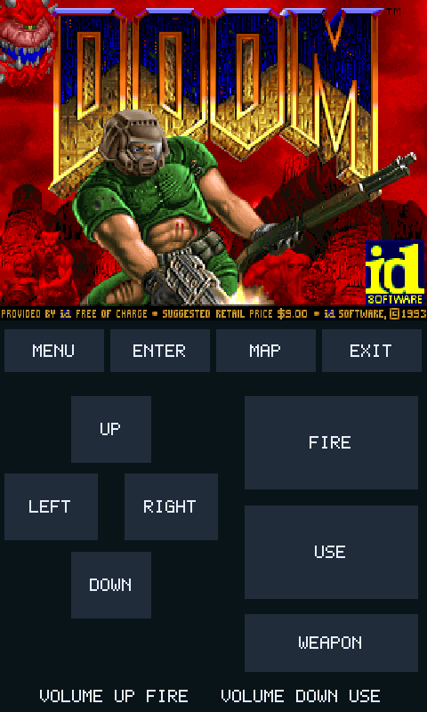
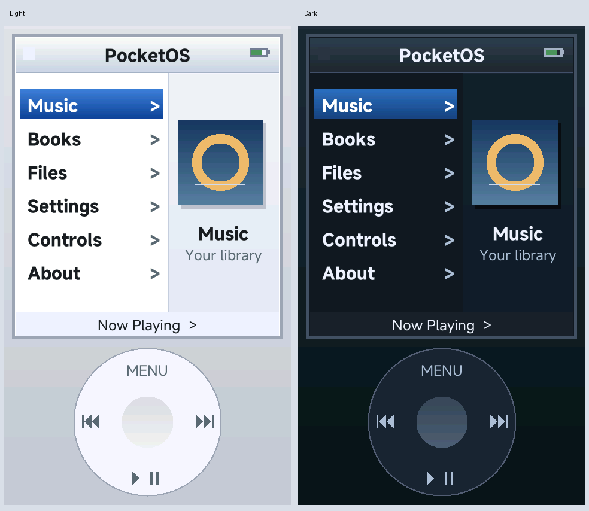

# Device and mode previews

The Doom image is a device framebuffer capture of the final port. The mode
comparison is a native-resolution renderer preview. Main-menu layout gained
Games afterward; fonts and modes use the same renderer and canvas.
