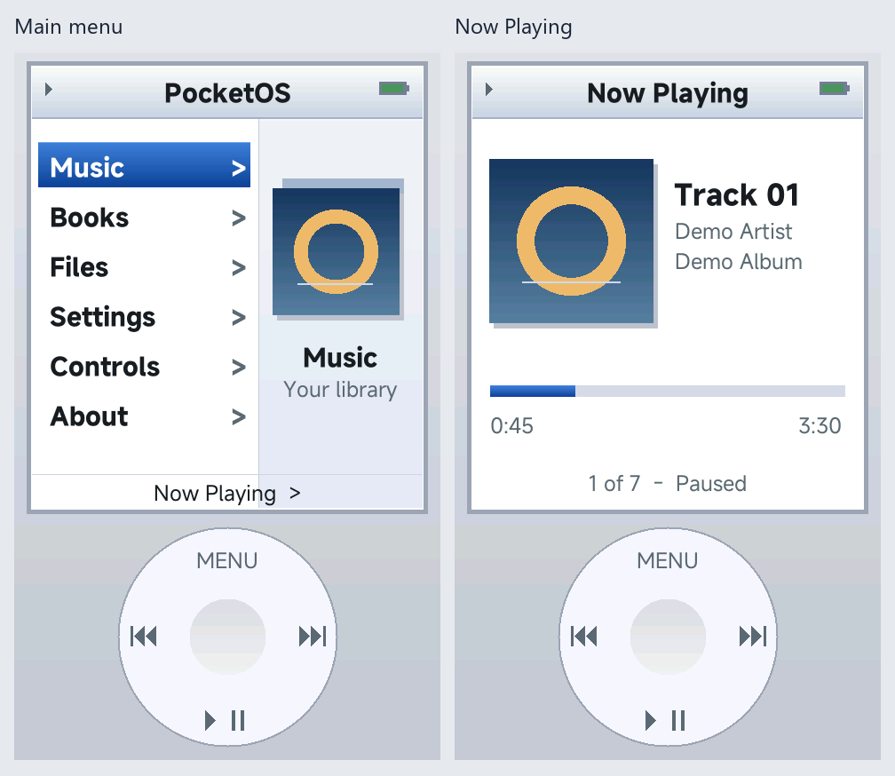
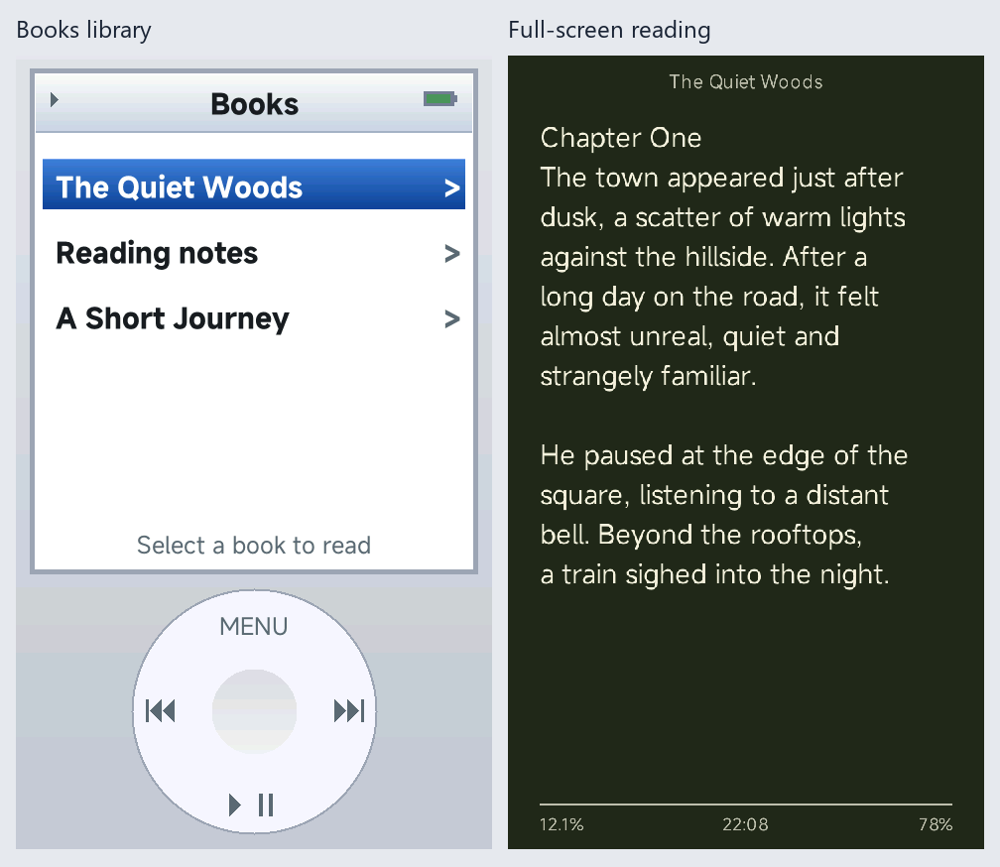
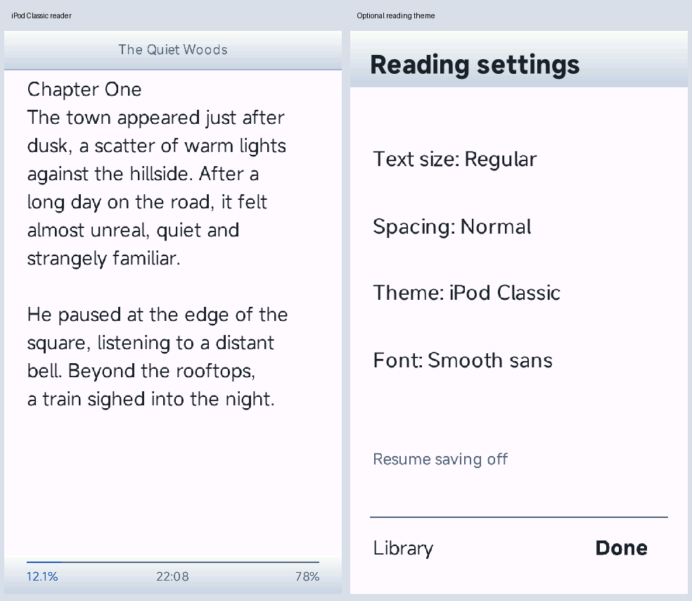

# Classic design and temporary functional preview

The proposed direction uses compact silver LCD headers, blue gradient selection,
a split menu/context-artwork view, and an on-screen wheel. Images are rendered at
480x800 using the approved PocketOS native glyphs and RGB565 colors. Metadata and
album artwork are synthetic demonstration content, with no personal files.

## Reading transition

The owner selected this visual direction and asked how reading would work.
Opening a book hides the shell frame and software wheel and uses the entire
480x800 panel. Left/right taps turn pages; a center tap opens existing reading
settings for font, size, spacing and Library. Returning to Library restores the
Classic controls. The reading half of this image is rendered by the existing
working PocketOS reader with generic sample text, not a newly implemented reader.
Its approved typography and font choices are retained. No new reader engine,
second canvas or image cache is proposed. Integrated UI RAM still needs testing.

The original images above are **visual concepts**, not device screenshots.
`tools/render-classic-concept.c` is a standalone host renderer, with no device,
flash or update access. The interactive core is now implemented below, while
detailed settings still use the existing full-screen controls. The reader retains
its full-screen layout rather than reserve space for a wheel.

The same-or-lower RAM requirement remains mandatory. The renderer demonstrates
one RGB565 canvas with procedural shapes, native glyphs and no image-texture
cache. It must be integrated into the existing canvas; linking an extra canvas
into the real UI would violate that intent. The prior functional draft's ELF/RAM
comparison is not proof of this concept's integrated RAM use. Actual RSS/peak still needs a matched-state comparison before a permanent update.
The owner approved the functional wheel preview on the R1.

## Functional device review — unpublished

The owner requested a preview on the R1 before publication and rejected the
seven-scene image viewer as insufficiently functional. The interactive draft
now integrates the Classic drawing primitives into the actual shell's existing
RGB565 canvas, behind `--classic-ui`. No second canvas is linked into the shell.

Home, Music, Books, Settings and Now Playing use the Classic LCD and software
wheel. Circular touch movement changes selection clockwise/counterclockwise.
The centre opens the selection; MENU goes back; the bottom button plays/pauses.
Side buttons change tracks while playing, or step through menus while idle.
Music browsing has a separate cursor and does not interrupt the current decoder.
Now Playing uses the wheel for volume; the centre toggles seeking. Physical
volume controls retain the existing gain limits and confirmation behavior.
Detailed settings, file operations, wireless controls and reading continue to
use their working full-screen controls; these screens are not yet wheel menus.

The optional reader theme is `iPod Classic`, after Olive: a light page, dark
text, compact silver title/footer and blue progress accent. The Olive default,
other themes, fonts, wrapping and page dimensions are retained. The existing
Olive demo render is byte-identical. Classic theme selection uses the existing
per-book bookmark format. Tests cover persistence and legacy bookmarks.

The temporary review wrapper verifies the existing PocketOS process, pauses it,
saves the framebuffer, and restores its pixels, backlight and process after at
most ten minutes. The candidate runs only from `/tmp`, with a temporary copy of
preferences and without update, file-write or bookmark-write permissions.
Exclusive touch/volume input prevents queued preview gestures reaching the
paused application. A short interactive launch/restore test passed before the
longer owner test; the installed shell's digest was unchanged.

The full host suite passes, as do MIPS self-test, Classic navigation tests,
existing navigation guards and updater tests. Seven host/MIPS preview scenes
match exactly. Wheel tests cover direction, wraparound, bounds, menu return,
track selection without interrupting browsing, and the playback command path.
These software checks do not replace the owner's physical wheel test.

The current target's static footprint is 1,599,132 bytes, versus 1,810,444 bytes
for installed update 2; BSS is 1,244,192 versus 1,244,176 bytes. These are build
figures, not proof of lower actual RAM. The initial interactive process was
observed at 2,700 KiB RSS/peak; the older process at a different, idle state was
2,308 KiB RSS / 2,704 KiB peak. The states are not comparable, so RAM acceptance
is still pending matched device measurements. Do not advertise a RAM reduction.

Light/dark palettes are requested after the first UI update. They must reuse
the existing canvas and fonts; same-or-lower actual RAM remains a release gate.

The installed system remains approved update 2. No firmware image, persistent
UI installation or update-channel change accompanies the temporary tests.
The owner approved the interactive preview and requested publication to GitHub.
Source publication does not change the installed firmware or update channel.
Firmware packaging/installation remains gated on the RAM comparison.

Host rendering uses the generated compact `pocketos-reader-font.h` include path:

    cc -Os -Wall -Wextra -Werror -Wno-unused-const-variable -I FONT_HEADER_DIR tools/render-classic-concept.c -o classic-concept
    ./classic-concept home home.ppm
    ./classic-concept music music.ppm
    ./classic-concept settings settings.ppm
    ./classic-concept player player.ppm
    ./classic-concept books books.ppm
