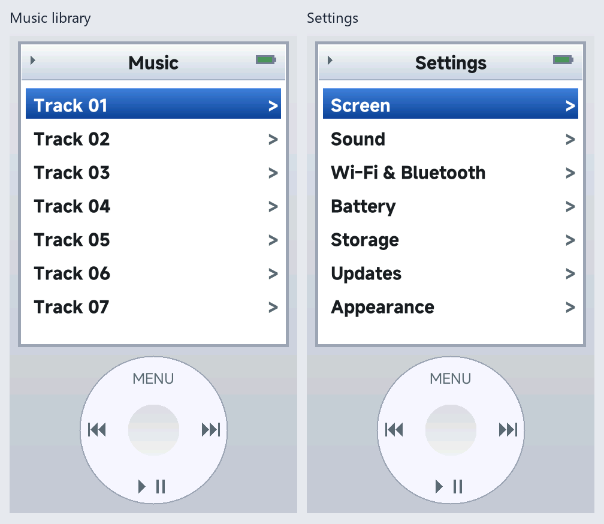

# Original-Classic-inspired visual concept — approval pending

The proposed direction uses compact silver LCD headers, blue gradient selection,
a split menu/context-artwork view, and an on-screen wheel. Images are rendered at
480x800 using the approved PocketOS native glyphs and RGB565 colors. Metadata and
album artwork are synthetic demonstration content, with no personal files.

This is a **visual concept**, not an installed or functionally complete UI.
`tools/render-classic-concept.c` is a standalone host renderer, with no device,
flash or update access. The wheel, menu interaction and contextual artwork need
approval and integration into the actual shell. The reading page should retain
its full-screen layout rather than reserve space for a wheel.

The same-or-lower RAM requirement remains mandatory. The renderer demonstrates
one RGB565 canvas with procedural shapes, native glyphs and no image-texture
cache. It must be integrated into the existing canvas; linking an extra canvas
into the real UI would violate that intent. The prior functional draft's ELF/RAM
comparison is not proof of this concept's integrated RAM use. Actual RSS/peak
and controls must be tested after implementation during an approved temporary
device test, before any permanent update.

The R1 continues running approved system update 2. No UI update, firmware image
publication or device installation accompanies this visual proposal. All work
remains in the UI review branch, and the device update channel stays on version 2.

Host rendering uses the generated compact `pocketos-reader-font.h` include path:

    cc -Os -Wall -Wextra -Werror -Wno-unused-const-variable -I FONT_HEADER_DIR tools/render-classic-concept.c -o classic-concept
    ./classic-concept home home.ppm
    ./classic-concept music music.ppm
    ./classic-concept settings settings.ppm
    ./classic-concept player player.ppm
