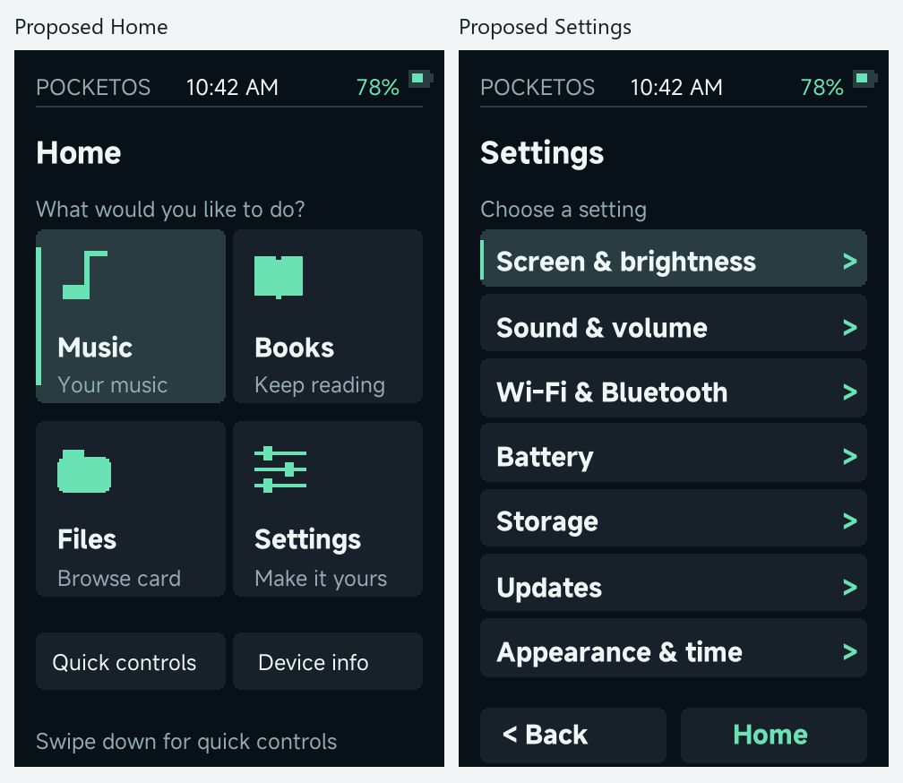
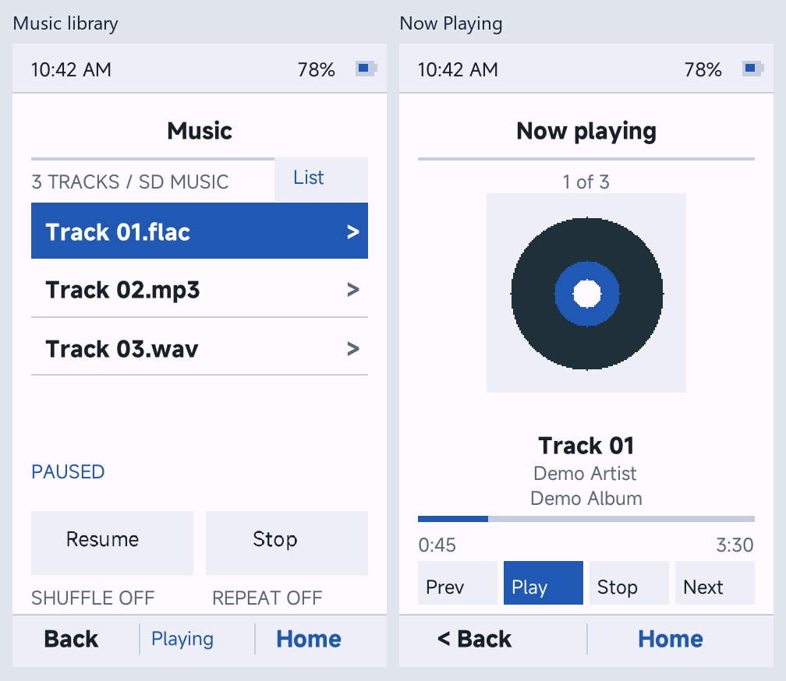

# Classic player UI proposal — not installed

The current design review is the [closer-to-original Classic visual concept](../ui-concepts/README.md).
The functional list-based draft below is retained as development history and
has not been approved or installed. Its memory figures do not certify the newer
concept's integrated RAM use.

The proposed interface is a complete list-based visual system inspired by classic
music-player menus. It uses a light LCD-style palette, blue full-row selection,
centered titles, a compact clock/battery bar, flat dividers, and simple Back/Home
navigation. Home and Quick controls are lists. Music, Books, Files and wireless
lists use the same selection language. Now Playing has a new record/artwork area,
centered metadata, a slim seek bar and explicit playback controls. Night and
high-contrast themes remain available.

These are native-resolution host-rendered previews with deterministic sample
battery/time, generic media and a simulated paused track. They are not device
screenshots. No new UI has been applied to the R1; it still runs approved system
update 2. Preview and owner approval are required before a temporary UI test or
permanent update. The firmware channel remains on system update 2.

## Memory evidence

| MIPS ELF metric | Installed UI | Classic proposal |
| --- | ---: | ---: |
| Code + read-only data | 564,340 bytes | 340,732 bytes |
| Initialized data | 1,928 bytes | 1,948 bytes |
| BSS / large working buffers | 1,244,176 bytes | 1,244,176 bytes |
| Total static footprint | 1,810,444 bytes | 1,586,856 bytes |
| Writable load pages (4 KiB) | 306 | 306 |

The static footprint is 223,588 bytes (218.3 KiB) smaller.

The native RGB565 framebuffer count and dimensions are unchanged. The UI keeps
the approved font glyphs; the lossless compact storage is retained and decoded
straight into the existing canvas. No extra framebuffer, decompression cache,
heap allocation, UI framework, animation loop or polling service is added.

This is not an on-device RAM comparison. The freshly booted update-2 UI was
observed at 2,312 KiB RSS and 2,704 KiB peak. The proposed UI must still be measured
on the R1 in matching states during an approved temporary test. Same-or-lower
actual RAM remains a release gate; ELF footprint alone does not prove it.

## Validation and preserved behavior

The complete host application suite passes. MIPS SDK self-test, navigation and
updater tests pass. Twelve host/MIPS screen renders match exactly: main menu,
Settings, Music, Books, Files, reader, Updates, Quick controls, Connections,
Wi-Fi, Bluetooth and Now Playing. Lossless glyph storage was independently
checked against all original packed glyphs and six baseline screen images.

Touch and key hit areas now follow the list layout. Busy updater/file/radio and
volume-confirmation guards remain. Home preserves active music playback; Back
restores menu selection. Reader typography/font choices and all recovery,
bootloader, update-writer and radio behavior are unchanged by this UI proposal.
No personal files, network credentials, device identifiers or raw logs are included.
